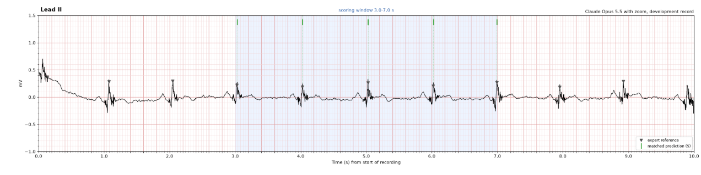
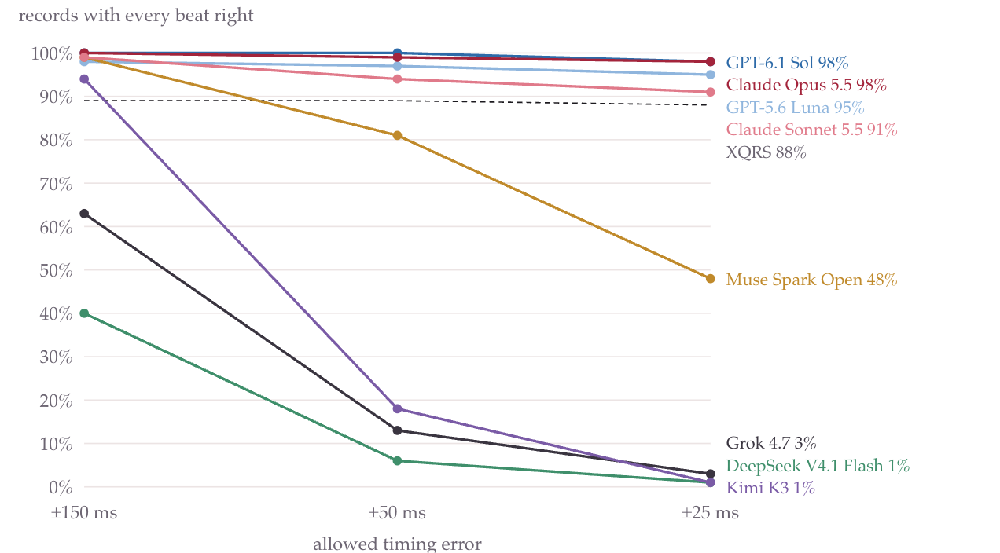
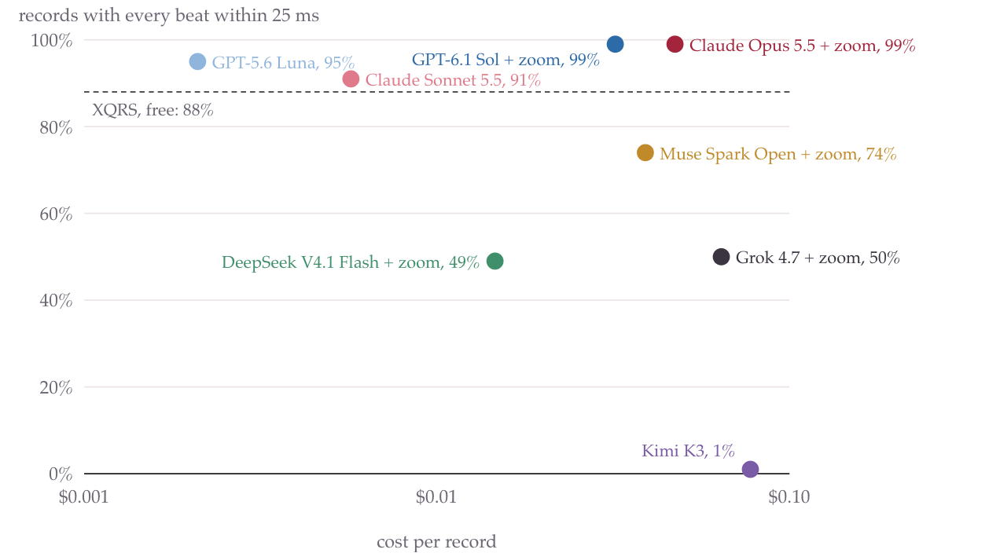

# ECG Landmark Bench

How precisely can general-purpose AI models locate heartbeats on an image of an ECG?

This benchmark gives eight closed and open-weight vision-language models a picture of a
real ten-second ECG and asks for the time of every QRS peak. Their answers are scored
against marks placed by cardiologists, at tolerances from 150 ms down to 25 ms, with and
without a zoom tool the model can call.

**[Read the full report](https://cbudries-cloud.github.io/ecg-landmark-bench/site/)**



## Why

ECGs are moving out of the clinic and into wearables, and people increasingly ask
general-purpose models to read them. Locating each beat is one of the first steps in
reading an ECG: it gives the heart rate and anchors every later measurement. This project
tests that step on clean images. It does not test diagnosis, and it does not test noisy
wearable recordings.

## Results

100 held-out records, 462 expert-marked beats, one attempt per record. A record passes
only if every beat in the scored window is within the tolerance and no beat is added.

| Model | Weights | Input | Pass ±150 ms | Pass ±25 ms | p95 error (ms) | No answer | Cost / record |
|---|---|---|--:|--:|--:|--:|--:|
| GPT-6.1 Sol | closed | image + zoom | 100% | 99% | 4 | 0% | $0.032 |
| Claude Opus 5.5 | closed | image + zoom | 100% | 99% | 6 | 0% | $0.047 |
| GPT-6.1 Sol | closed | image | 100% | 98% | 6 | 0% | $0.008 |
| Claude Opus 5.5 | closed | image | 100% | 98% | 10 | 0% | $0.012 |
| GPT-5.6 Luna | closed | image + zoom | 98% | 95% | 8 | 0% | $0.007 |
| GPT-5.6 Luna | closed | image | 98% | 95% | 10 | 0% | $0.002 |
| Claude Sonnet 5.5 | closed | image | 99% | 91% | 18 | 0% | $0.006 |
| Claude Sonnet 5.5 | closed | image + zoom | 98% | 89% | 20 | 0% | $0.007 |
| Muse Spark Open | open-weight | image + zoom | 74% | 74% | 11 | 26% | $0.039 |
| Grok 4.7 | closed | image + zoom | 96% | 50% | 44 | 0% | $0.064 |
| DeepSeek V4.1 Flash | open-weight | image + zoom | 77% | 49% | 60 | 12% | $0.015 |
| Muse Spark Open | open-weight | image | 99% | 48% | 48 | 0% | $0.020 |
| Grok 4.7 | closed | image | 63% | 3% | 124 | 0% | $0.067 |
| Kimi K3 | open-weight | image | 94% | 1% | 109 | 0% | $0.077 |
| DeepSeek V4.1 Flash | open-weight | image | 40% | 1% | 130 | 15% | $0.009 |
| XQRS (signal baseline) | open source | raw signal | 89% | 88% | 6 | n/a | $0 |

What the numbers show:

- **Precision, not detection, separates the models.** At ±150 ms most models find
  nearly every beat. At ±25 ms the field spreads from 99% to 1%. The best models' p95
  error is close to one image pixel (about 4.5 ms).
- **GPT-6.1 Sol and Claude Opus 5.5 are effectively tied.** Both pass 99% of records at
  ±25 ms with zoom; the 2 ms gap in p95 error is within run-to-run variation.
- **Price does not predict accuracy.** GPT-5.6 Luna passes 95% at $0.002 per record.
  Kimi K3, the most expensive per record, passes 1%.
- **Some errors are systematic.** Grok 4.7 and Kimi K3 find most beats from the image
  alone but mark them 35 to 38 ms late on average, so almost every record fails at ±25 ms.
- **Zoom changed the weakest models most.** Grok rose from 3% to 50% at ±25 ms and
  DeepSeek from 1% to 49%. Muse Spark Open became more precise but returned no usable
  answer on 26% of records.
- **XQRS**, a basic open-source detector reading the raw signal, missed every beat on
  the three pacemaker records. It is a reference point, not a state-of-the-art baseline.





## Method

- **Data.** [LUDB 1.0.1](https://physionet.org/content/ludb/1.0.1/): 200 ten-second
  12-lead recordings at 500 Hz, with P, QRS and T waves annotated by cardiologists. The
  benchmark uses Lead II and the annotated QRS peaks.
- **Task.** The model sees one rendered image on standard ECG grid paper, with no record
  ID or labels, and returns `{"qrs_peaks_s": [...]}` for the beats between 3 and 7 s
  (the region every record has annotated). In the zoom condition it may call a tool up to
  six times to render any time range at higher resolution.
- **Scoring.** Predictions and expert marks are paired one to one with optimal assignment,
  maximizing matches within the tolerance and then minimizing total distance. Reported:
  record pass rate, F1 and absolute timing error, at ±150, ±50 and ±25 ms.
- **Protocol.** Records were split at random into 100 development and 100 held-out
  records. Prompts, rendering, scoring and analysis were settled on development data and
  frozen; the frozen settings are hashed, and the runner refuses to touch held-out data if
  any of them changes. Held-out records were run once, with no tuning.
- **Statistics.** 95% intervals from a case-level bootstrap (10,000 resamples); the zoom
  effect is a paired difference on the same resamples. Pacemaker and atrial fibrillation
  records are reported as subgroups.

Full details: [`docs/protocol.md`](docs/protocol.md) and [`docs/dataset.md`](docs/dataset.md).

## Engineering

- **Provider-agnostic adapters.** One adapter for the Anthropic API and one for any
  OpenAI-compatible endpoint (hosted routers, OpenAI, Gemini, or a local vLLM or Ollama
  server). Both share the same prompt, image and zoom-tool loop.
- **Answer keys stay isolated.** Model-facing code receives only the image and case
  geometry; expert annotations live in a separate private store used only by the scorer.
- **Resumable, parallel runs.** Every attempt is checkpointed by
  (case, model, condition, attempt), so interrupted runs resume where they stopped.
  `--shard k/n` splits a run across workers that append to one log atomically.
- **Cost control.** Spend is estimated from reported token usage and a per-model price;
  the runner refuses unpriced models and stops before a configured cap.
- **Full audit trail.** Each attempt logs the request settings, raw reply, tool calls,
  token usage, cost, latency, serving host and score.
- **Tested.** 58 tests cover the scorer, response parser, rendering pipeline, both
  adapters (against mocked HTTP transports), the bootstrap and the subgroup rules.

## Reproduce

Requires Python 3.11+.

```bash
python3 -m venv .venv
.venv/bin/pip install -r requirements.txt && .venv/bin/pip install -e .
```

Download LUDB 1.0.1 and verify its checksums:

```bash
mkdir -p data/raw/ludb-1.0.1 && cd data/raw/ludb-1.0.1
B=https://physionet.org/files/ludb/1.0.1
for f in README RECORDS LICENSE.txt SHA256SUMS.txt ANNOTATORS ludb.csv; do curl -sfO $B/$f; done
awk '{print $2}' SHA256SUMS.txt | grep '^data/' | xargs -P 16 -I{} curl -sf --create-dirs -o {} $B/{}
awk '{print $1"  "$2}' SHA256SUMS.txt | shasum -a 256 -c - | grep -vc ': OK$'   # prints 0
cd ../../..
```

Prepare the data, run the tests and the signal baseline:

```bash
.venv/bin/python -m ecgbench.cli prepare
.venv/bin/pytest -q
.venv/bin/python -m ecgbench.cli baseline --partition dev
```

Model runs read API keys from a git-ignored `.env` file: `ANTHROPIC_API_KEY` for Claude,
and `ROUTER_API_KEY` plus `ROUTER_BASE_URL` for models behind an OpenAI-compatible router.

```bash
.venv/bin/python -m ecgbench.cli run --model claude-opus-5-5 --partition dev --limit 2 --run-name smoke
.venv/bin/python -m ecgbench.cli report --partition test --confirm-heldout \
    --runs results/heldout/runs/heldout-v1-*/attempts.jsonl
.venv/bin/python scripts/build_site.py
```

Adding a model takes a config entry and a price: see [`docs/models.md`](docs/models.md).

## Repository layout

| Path | Contents |
|---|---|
| `src/ecgbench/` | Data loading, rendering, scoring, model adapters, runner, analysis, CLI |
| `config/` | Benchmark settings, versioned prompts, the dev/held-out split |
| `results/heldout/` | Every held-out attempt, the signal baseline, bootstrap and subgroup tables |
| `results/dev/` | Development runs used to settle the protocol |
| `docs/` | Protocol, dataset notes, model guide, the results page |
| `scripts/build_site.py` | Builds the results page from the result files |
| `tests/` | Test suite |

## Limitations

The test set is small (100 records, three of them paced), each model answered each record
once, and LUDB is public, so some models may have seen it during training. A single
consensus answer key means disagreement between experts cannot be measured. Clean
ten-second strips from one device are easier than wearable recordings or photographs of
paper ECGs. Nothing here evaluates clinical use.

## Credits and license

Data: Kalyakulina A.I. et al., "LUDB: A New Open-Access Validation Tool for
Electrocardiogram Delineation Algorithms," *IEEE Access* 8:186181–186190 (2020);
Goldberger A. et al., "PhysioBank, PhysioToolkit, and PhysioNet," *Circulation*
101(23):e215–e220 (2000). LUDB is distributed under the Open Data Commons Attribution
License 1.0 and is not included in this repository.

Code is released under the [MIT License](LICENSE).

Built by [Colin Budries](https://colinbudries.com).
